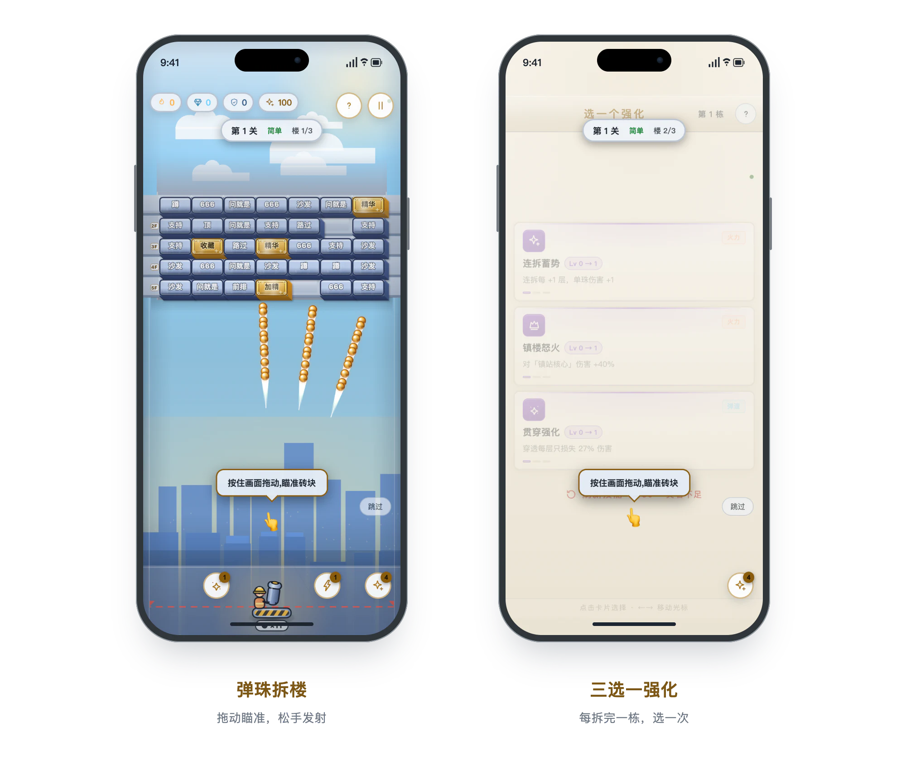

# 拆楼弹珠

一个以论坛水楼为题材的弹珠游戏。拖动瞄准，松手发射，赶在楼压下来之前把它拆掉。

[本地运行](#本地运行)

<p align="center">
  <picture>
    <source media="(prefers-color-scheme: dark)" srcset="docs/images/hero-dark.webp">
    <source media="(prefers-color-scheme: light)" srcset="docs/images/hero-light.webp">
    
  </picture>
</p>

## 怎么玩

楼里的砖块叫「水贴」「神帖」「引战」「回帖」……「引战」会炸到周围的砖，「回帖」会帮附近的砖回血。

每拆完一栋，从三张强化卡里选一张。有分身、穿透、暴击，也有毒和火，一共 19 种，可以叠加。攒够灵石还能重抽。

每五栋会遇到一次 Boss，要先打掉护甲，再打核心。打赢后可以选遗物，不过遗物通常也带着副作用。

选到的强化只在这一局有效。灵石能带回商店，用来买永久升级。还有每日挑战，同一天使用相同种子生成楼栋。

## 操作

- **手机**：按住拖动瞄准，松手发射。
- **电脑**：鼠标操作，或用 **← →** 瞄准、**空格 / Enter** 发射、**Esc / P** 暂停。

进度自动存在本地，可以关掉后继续。换浏览器或网址前，先在设置里导出存档。

明暗主题默认跟随系统。音效、震屏和减少动效也可以在设置里调整。

## 本地运行

需要 [Bun](https://bun.sh/) 1.4 或更新版本。

```sh
bun install
bun run dev
```

浏览器打开 **<http://localhost:5194/>**。手机与电脑连接同一 Wi-Fi 后，也可以用电脑的局域网 IP 加 `:5194` 打开。

<details>
<summary>部署与开发</summary>

### Vercel

仓库里有 [vercel.json](vercel.json)，导入 Vercel 时使用以下配置：

| 配置 | 值 |
| --- | --- |
| 安装命令 | `bun install --frozen-lockfile` |
| 构建命令 | `bun run build:h5` |
| 输出目录 | `dist/web` |

不需要后端或环境变量。部署后可以直接分享网址。

### 构建

普通网页使用 `localStorage` 存档、跟随系统主题；linux.do 快应用使用宿主的存储、主题与用户能力。核心玩法共用同一份代码。

```sh
bun run build:h5        # 独立网页 → dist/web/
bun run preview:h5      # 预览生产构建 → http://localhost:5195/
bun run build:miniapp   # linux.do 快应用 → dist/package/app.zip
bun run check          # 类型、架构约束、129 项单测、13 项浏览器验收
```

SDK 通过 `file:./sdk` 引入，部署时需保留该目录。静态构建需要通过 HTTP(S) 访问。

TapTap 使用 `dist/web/` 中的站点文件打 H5 zip，按[官方流程](https://developer.taptap.cn/agents/)上传、自测和提审。linux.do 使用 `dist/package/app.zip`。

### 素材与权限

游戏画面由 Canvas 与内联 SVG 绘制，音效由 WebAudio 合成；不加载外部字体、图片或音频。linux.do 端只申请 `user.read`、`theme.read`、`storage.read`、`storage.write` 四项权限。

### 已知不足

Boss 目前以护甲机制为主，单局节奏还需要更多真人反馈；DPR 3 暂未实测。

### 更新 README 展示图

开发服务器运行时执行 `node scripts/readme-assets.mjs`。脚本使用本机 Chrome 截取真实游戏状态，生成明暗两版手机机框图；需要切换地址时设置 `README_URL`。

</details>
